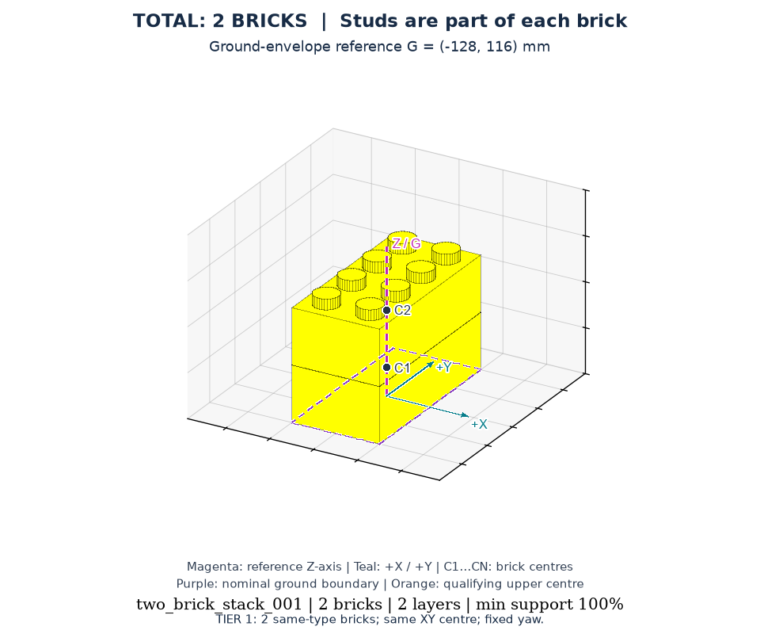
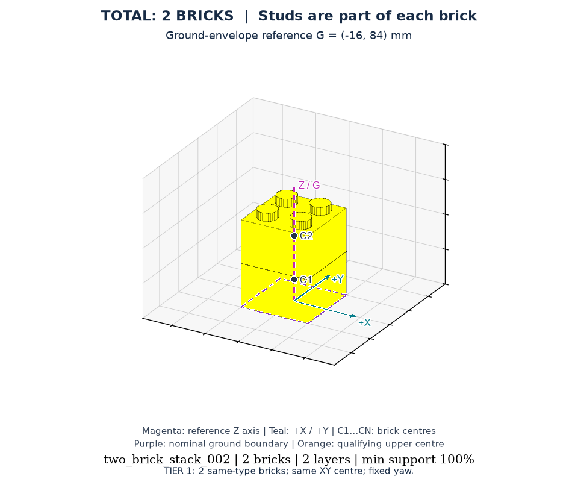
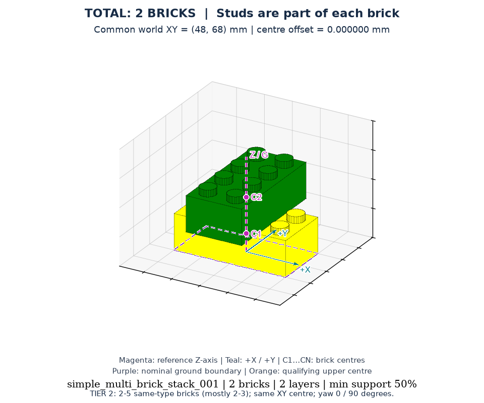
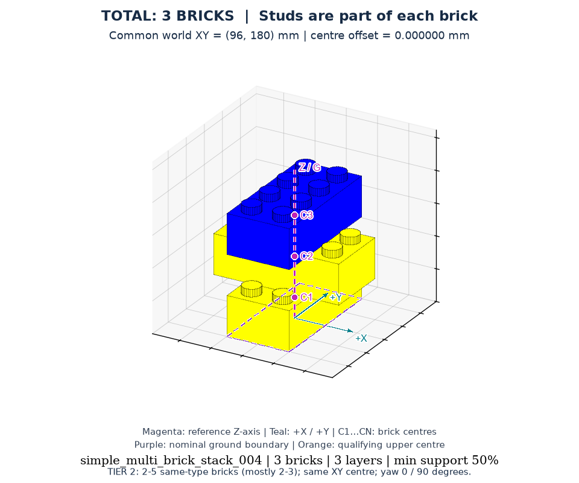
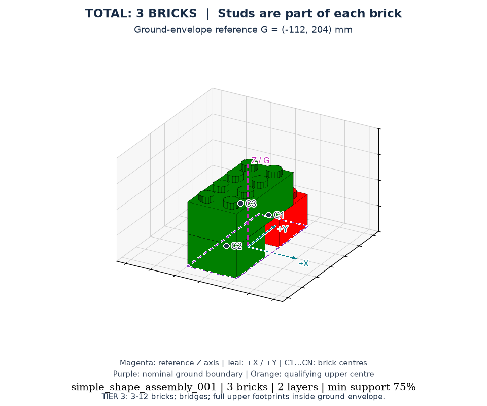
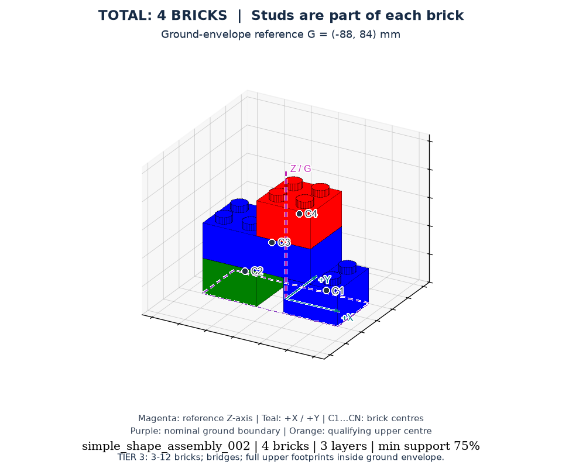
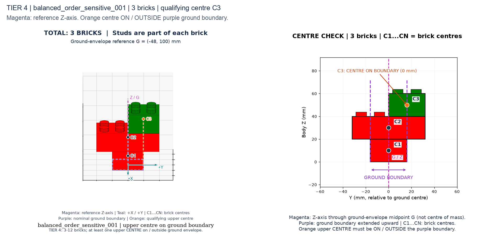
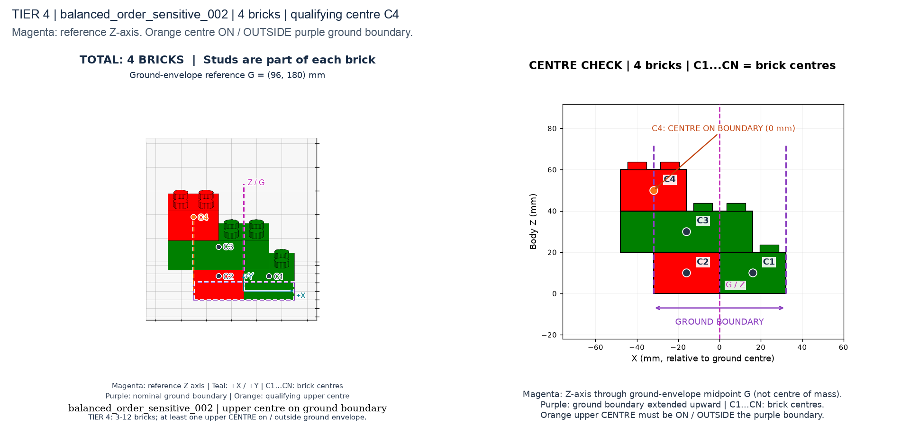

# WorkBenchMark：模块化积木装配任务集

WorkBenchMark 面向机器人积木装配研究，提供从初始散件到目标结构的配对任务。当前版本包含四个难度层级、共 400 个任务，使用 2×2 和 4×2 两种积木。任务以 YAML 描述，配套确定性生成器、独立静态校验器、几何检查图和评估接入接口，可用于研究抓取、装配、结构条件策略及不同方法的任务完成情况。

This repository provides 400 structured brick-assembly tasks across four tiers, with paired initial and goal states, reproducible generation, static verification, and annotated visual previews. The canonical dataset is `versions/latest/tasks/`. Robot execution and simulator integration are maintained in the companion [robot_korea repository](https://github.com/ma-haha-hehe/robot_korea).

[四个 Tier 的定义与标注读图](versions/latest/images/tier_definitions.html) · [中文定义文档](docs/tier_definitions.md)

**实际使用最新版：`versions/latest/`。** [打开四个 Tier 的图片入口](versions/latest/images/index.html) · [新旧版本导航](versions/index.html)

## 最新版示例图片

下图均来自当前 `versions/latest/tasks/`，采用论文风格并标出结构参考轴、砖中心与底层边界。点击图片查看原图，点击实例编号查看对应任务。完整图片在任务目录旁的 [versions/latest/images/](versions/latest/images/)，共 497 张；每个 Tier 有 12 个精选样例，Tier 4 另包含全部 100 个任务的中心边界检查。

| Tier | 示例一 | 示例二 | 更多图片 |
|---|---|---|---|
| **Tier 1**：2 块，同中心、固定朝向 | <br>[two_brick_stack_001](versions/latest/tasks/two_brick_stack/two_brick_stack_001/) | <br>[two_brick_stack_002](versions/latest/tasks/two_brick_stack/two_brick_stack_002/) | [12 例总览](versions/latest/images/tier_1/overview.png) · [全部视图](versions/latest/images/tier_1/) |
| **Tier 2**：中心一致，仅 0°/90° | <br>[simple_multi_brick_stack_001](versions/latest/tasks/simple_multi_brick_stack/simple_multi_brick_stack_001/) | <br>[simple_multi_brick_stack_004](versions/latest/tasks/simple_multi_brick_stack/simple_multi_brick_stack_004/) | [12 例总览](versions/latest/images/tier_2/overview.png) · [全部视图](versions/latest/images/tier_2/) |
| **Tier 3**：上层砖体在底层包络内 | <br>[simple_shape_assembly_001](versions/latest/tasks/simple_shape_assembly/simple_shape_assembly_001/) | <br>[simple_shape_assembly_002](versions/latest/tasks/simple_shape_assembly/simple_shape_assembly_002/) | [12 例总览](versions/latest/images/tier_3/overview.png) · [全部视图](versions/latest/images/tier_3/) |
| **Tier 4**：上层砖中心在边界上或外部 | <br>[balanced_order_sensitive_001](versions/latest/tasks/balanced_order_sensitive/balanced_order_sensitive_001/) | <br>[balanced_order_sensitive_002](versions/latest/tasks/balanced_order_sensitive/balanced_order_sensitive_002/) | [12 例中心总览](versions/latest/images/tier_4/center_overview.png) · [全部 100 例检查](versions/latest/images/tier_4/) |

## 仓库结构

```text
Workbenchmark/
├── versions/
│   ├── latest/                 当前实际使用的版本
│   │   ├── tasks/              400 个完整任务，Tier 1–4 各 100 个
│   │   └── images/
│   │       ├── tier_1/         12 个精选样例，多视图
│   │       ├── tier_2/         12 个精选样例，共同中心检查
│   │       ├── tier_3/         12 个精选样例，桥接与分层检查
│   │       └── tier_4/         12 个精选样例＋全部 100 个中心边界检查
│   └── initial/                初次生成版本，完整任务与最初图片
├── tasks/                      远端原始的 400 个任务，只作历史存档
├── scripts/                    生成、校验、渲染、评估脚本
├── assets/meshes/               原始积木 STL 网格
├── tests/                      生成器与校验器测试
├── docs/                       详细几何、格式和生成约定
└── 版本导航.md                  中文路径说明
```

各版本的 `images/manifest.csv` 保存实例编号、种子、任务路径、源文件校验和与图片文件名，是数据集的对应关系索引。每次运行产生的日志、评估结果和调试输出保存在本地，不属于发布数据。

## 每个 Tier 的对应任务与图片

| Tier | 最新任务目录（在 versions/latest/tasks/ 下） | 最新图片入口 | 核心规则 |
|---|---|---|---|
| 1 | `two_brick_stack/` | [Tier 1](versions/latest/images/tier_1/index.html) | 2 块，同类型、同中心、固定朝向 |
| 2 | `simple_multi_brick_stack/` | [Tier 2](versions/latest/images/tier_2/index.html) | 2–5 块，以 2–3 块为主，同类型、XY 中心一致，朝向只允许 0°/90° |
| 3 | `simple_shape_assembly/` | [Tier 3](versions/latest/images/tier_3/index.html) | 3–12 块，桥接连接，砖体不超出底层整体边界 |
| 4 | `balanced_order_sensitive/` | [Tier 4](versions/latest/images/tier_4/index.html) | 3–12 块，至少一块上层砖的 XY 中心在底层边界上或外部 |

Tier 2 的 100 个任务为 **2 块 43 个、3 块 42 个、4 块 8 个、5 块 7 个**，即 85% 为 2–3 块、15% 为 4–5 块。允许 2 块后，其同朝向样例可能与 Tier 1 外观重叠；Tier 2 仍采用独立 0°/90° 朝向策略。

Tier 3/4 数据各保持 **80% 为 3–5 块、15% 为 6–8 块、5% 为 9–12 块**，最多三层、直线平行布局。精选图像优先展示小砖数，同时保留范围检查样例；精选样例比例不等于完整数据集比例。

每个精选样例使用任务实例 ID 命名的独立图片文件夹：

- `target.png`：目标三维图。
- `initial_to_target.png`：同一组积木从初始摆放到目标装配。
- `layers.png`：逐层 XY 检查图。
- `inspection.png`：正反目标视图、分层图、初始摆放的四图检查。
- Tier 2 的 `center_check.png`：共同中心与朝向检查。
- Tier 4 的 `center_side.png`、`center_inspection.png`：中心与底层边界检查。
- `source/`：对应样例的 YAML 对照副本；实际 benchmark 输入使用 `versions/latest/tasks/`。

最新版全部图片标注共同结构参考轴 G（洋红）、底层整体包络边界（紫色）、各砖中心 C1…CN、Tier 4 合格上层中心（橙色）及世界 X/Y 方向（青色）。G 取底层包络中点，各层共用同一个 G；G 不是重心。初始散件图使用料盘参考点 P。

TOTAL 表示实体积木数量，凸点不额外计数。不同视图展示同一个任务，不相加。默认采用 symposium paper Fig. 1/3 的纯色、实心凸点、灰色网格和黑轮廓风格。

## 使用

需要 Python 3.10 或更新版本。在仓库根目录创建环境并校验当前任务：

```sh
python3 -m venv .venv
source .venv/bin/activate
python3 -m pip install -r requirements.txt
python3 scripts/verifier.py --benchmark_root versions/latest/tasks
python3 -m unittest discover -s tests -v
```

已有图片可以直接查看。重新渲染时，再安装 `requirements-visualization.txt`：

```sh
python3 -m pip install -r requirements-visualization.txt
```

生成新数据或图片时使用新的输出目录，检查后再替换当前版本：

```sh
python3 scripts/generator.py --task_class all --num_samples 100 --output_dir /tmp/benchmark_tasks_new
python3 scripts/render_gallery.py --output /tmp/benchmark_gallery_new
```

生成器默认位置和渲染器输入都是 `versions/latest/tasks/`。每个任务有三个 YAML：`final_product.yaml`（目标）、`scene_init.yaml`（初始场景）、`metadata.yaml`（任务信息与规则）。位置单位为米，旋转单位为弧度，XY 原点在砖体中心，Z 是砖体底面。

## 任务格式与复现

一个任务实例对应一个独立目录，例如：

```text
versions/latest/tasks/simple_multi_brick_stack/simple_multi_brick_stack_001/
├── final_product.yaml     目标中每块积木的名称、类型、颜色和位姿
├── scene_init.yaml        相同积木的初始位姿、料盘与装配区域、几何参数
└── metadata.yaml          任务类别、种子、块数、规则版本和静态装配顺序
```

`name` 是场景与目标之间的对应标识；`type` 为 `brick_2x2` 或 `brick_4x2`；`pos` 为 `[x, y, z]`；`rotation` 为 `[roll, pitch, yaw]`。名义凸点间距为 16 mm，名义底面为 32×32 mm 或 64×32 mm，任务层间距为 20 mm。仿真端应显式处理实际网格、插接深度和接触几何，避免把凸点总高度直接当作层间距。

`metadata.yaml` 中的 `seed`、`num_blocks` 与任务类别共同确定生成输入。`verified: true` 对应 `validation_scope: static_grid_and_side_strip_proxy`，表示通过静态规则检查；`planner_checked: false` 表示未进行机器人规划认证。完整字段与复现方式见 [生成约定](docs/generation_contract.md)。

## 接入机器人或策略

机器人执行入口在配套的 [robot_korea](https://github.com/ma-haha-hehe/robot_korea) 中，包含任务导入、MuJoCo 执行、阶段状态机和抽样评估工具。将本仓库的 `versions/latest/tasks/` 作为任务输入；两个仓库分别维护，不需要把本地运行输出复制回任务目录。

本仓库的 `scripts/run_eval.py` 提供环境与策略适配接口、完成进度和 CSV 字段约定。接入新方法时，需要实现 `BenchmarkEnvAdapter` 的场景初始化、动作执行和状态读取，以及 `MethodRunner.act`。其中 `ours`、`pi0` 是预留适配器名称，`dry_run` 仅为接口占位；它们不是可直接复现实验成绩的已训练基线。详见 [脚本说明](scripts/README.md)。

比较不同方法时，应固定任务版本和实例列表，并明确观测来源、动作空间、终止条件、超时预算及成功容差。图片和静态校验可检查输入定义；机器人成功率应由实际运行与独立终态检查得出。

## 历史数据与验证范围

`versions/initial/` 是第一次生成的完整 400 个任务及其最初论文风格预览。根目录 `tasks/` 是远端原始数据，与初次生成版不同，两者都保持历史内容。

当前验证覆盖静态几何、支撑率、场景间距和简化抓取约束；图片不认证接触物理或实机平衡。`run_eval.py` 的环境和策略接口仍需接入实际仿真/基线。详细约定在 [docs/generation_contract.md](docs/generation_contract.md)。
