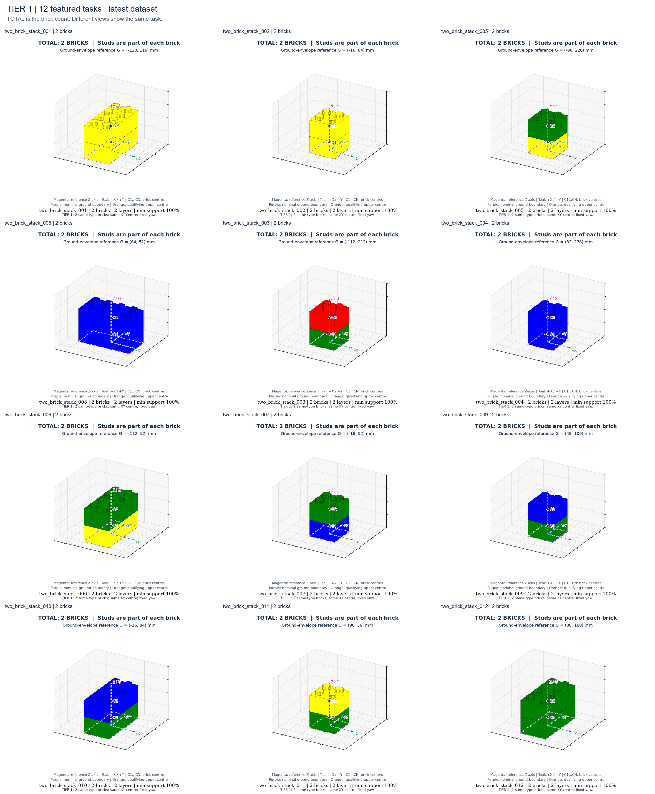
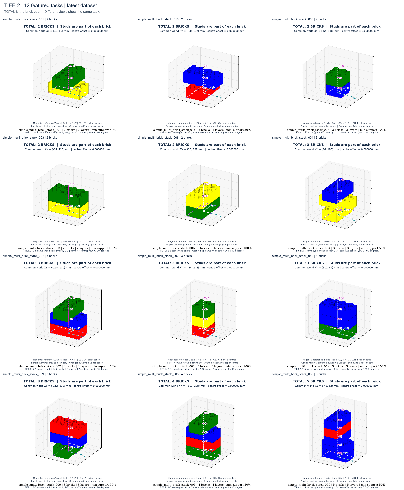
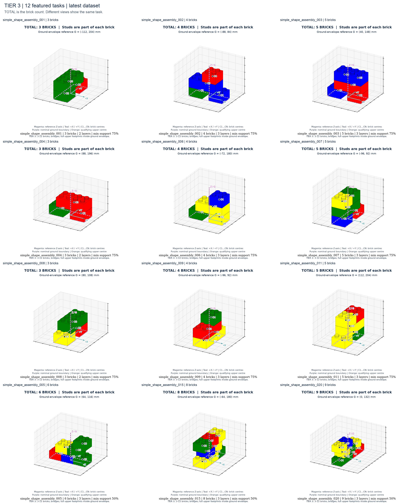
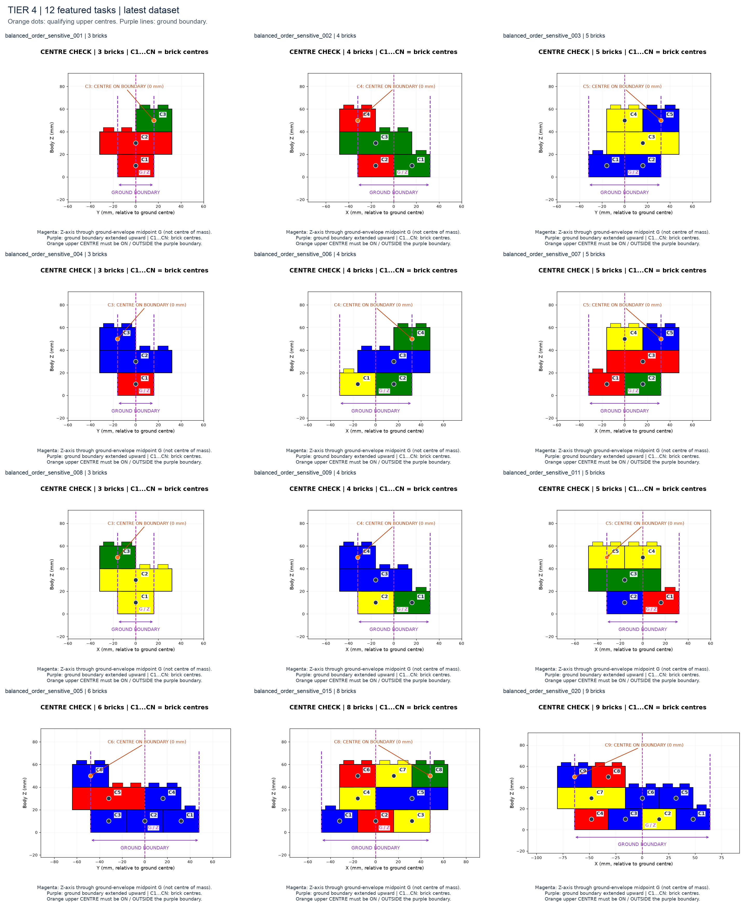

# 最新版：实际使用

**完整任务：tasks/**，400 个，四个 Tier 各 100 个。**图片总入口：[images/index.html](images/index.html)**。

| Tier | 任务子目录 | 图片入口 |
|---|---|---|
| 1 | tasks/two_brick_stack/ | [12 例多视图](images/tier_1/index.html) |
| 2 | tasks/simple_multi_brick_stack/ | [12 例＋共同中心检查](images/tier_2/index.html) |
| 3 | tasks/simple_shape_assembly/ | [12 例桥接与分层检查](images/tier_3/index.html) |
| 4 | tasks/balanced_order_sensitive/ | [12 例＋全部 100 例中心边界检查](images/tier_4/index.html) |

## 直接查看示例图

图片与 `tasks/` 保存在同一版本目录下。下方总览在 GitHub 上可直接显示，点击可查看原图；各任务的单独视图与对应 YAML 对照文件保存在 `images/tier_*/<实例编号>/`。

| Tier 1：12 个样例 | Tier 2：12 个样例 |
|---|---|
|  |  |
| [对应任务](tasks/two_brick_stack/) · [单独图片](images/tier_1/) | [对应任务](tasks/simple_multi_brick_stack/) · [单独图片](images/tier_2/) |

| Tier 3：12 个样例 | Tier 4：12 个中心边界样例 |
|---|---|
|  |  |
| [对应任务](tasks/simple_shape_assembly/) · [单独图片](images/tier_3/) | [对应任务](tasks/balanced_order_sensitive/) · [全部 100 例中心检查](images/tier_4/) |

每个任务图片放在对应 Tier 下面、以完整实例 ID 命名的文件夹中。任务本体是 tasks/，图片下 source/ 是检查副本。images/manifest.csv 保存图像、任务路径、生成种子与源文件校验和的对应关系。

在仓库根目录校验：python3 scripts/verifier.py --benchmark_root versions/latest/tasks。

[四个 Tier 的定义与标注读图](images/tier_definitions.html) · [中文定义文档](../../docs/tier_definitions.md)。洋红色是通过底层包络中点 G 的结构参考轴（不是重心），紫色是底层包络，C 编号是砖中心，橙点是 Tier 4 合格上层中心。初始散件图以料盘中心 P 为参考。

Tier 2 当前以 2–3 块为主：100 个任务中 2 块 43 个、3 块 42 个、4 块 8 个、5 块 7 个。图片先展示 10 个 2–3 块样例，再保留 4/5 块各 1 例。
